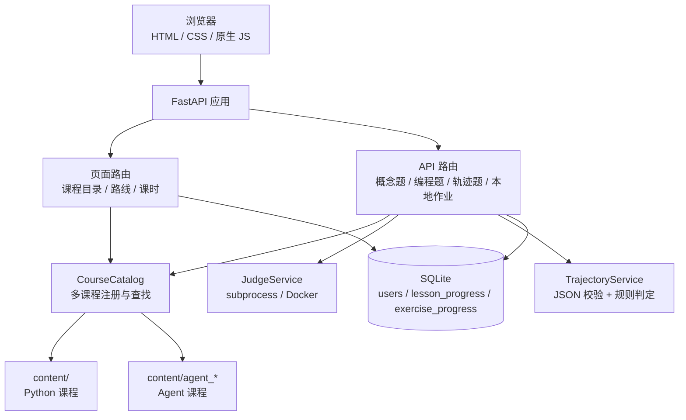

# 《从零开始Agent学习》Agent 开发课程系统设计

> 版本：v1.0  
> 日期：2026-11-03  
> 项目类型：实践周项目后续扩展 / 下学期长期课程  
> 配套文档：`AGENT_PRD.md`、`PRD.md`、`系统设计.md`  
> 当前状态：M13 A0–A3、M14 A4–A7 内容与 M15 结业项目及验收已完成

---

## 1. 设计目标与约束

### 1.1 目标

在不推翻现有 Python 课程的前提下，把平台扩展为**双课程**：

- `python`：已完成，L01–L11；
- `agent`：新增，a00–a23；
- 两门课程共享账号、课时页、视觉卡片、判题、进度与 CSRF/限流；
- 新增轨迹题：只解析 JSON、按规则判定，不执行 Agent 代码。

### 1.2 约束

- 不引入新数据库服务；
- 不引入前端框架；
- 不在服务端保存学员 API Key；
- 不在服务端代调用 LLM；
- 不在服务端执行 Agent 代码；
- 保持 `start.bat` 与本地 `python run.py` 可用；
- Python 课程的现有行为不能回归。

---

## 2. 总体架构



- 页面与接口都通过 `CourseCatalog` 查找课程、课时与练习；
- 概念题/填空/编程题沿用现有 JudgeService；
- 轨迹题只进入 TrajectoryService，不执行代码、不访问网络；
- 进度写入现有两张表，不新增表。

---

## 3. 多课程模型

### 3.1 课程注册

在 `app/content.py` 增加课程源：

```python
COURSE_SOURCES = [
    {
        "id": "python",
        "course_file": "course.json",
        "exercises_file": "exercises.json",
        "prerequisite": None,
    },
    {
        "id": "agent",
        "course_file": "agent_course.json",
        "exercises_file": "agent_exercises.json",
        "prerequisite": "python",
    },
]
```

- Python 课程文件保持原位，不迁移；
- Agent 课程使用独立 `agent_course.json`、`agent_exercises.json`、`agent_lessons/`；
- 课时 ID 全局唯一：Python `l01`，Agent `a00`；
- 练习 ID 全局唯一：Python `e01`，Agent `ag01`。

### 3.2 数据类

```python
@dataclass
class Course:
    id: str
    title: str
    description: str
    prerequisite: str | None
    stages: list[Stage]
    lessons: list[Lesson]
    ...

@dataclass
class CourseCatalog:
    courses: dict[str, Course]
    lesson_map: dict[str, Lesson]
    exercise_map: dict[str, Exercise]

    def get_course(self, course_id: str) -> Course | None: ...
    def get_lesson(self, lesson_id: str) -> Lesson | None: ...
    def get_exercise(self, exercise_id: str) -> Exercise | None: ...
```

- `Course.continue_lesson(completed_ids)` 只在本课程内查找；
- `Course.total_lessons` 只统计本课程；
- `lesson_map` 与 `exercise_map` 是全局索引，便于 `/lessons/{id}` 与 API 查找。

### 3.3 课程进度

- `lesson_progress` 仍按 `user_id + lesson_id` 存储；
- 课程完成度 = 本课程已完成课时数 / 本课程总课时数；
- Agent 与 Python 的课时 ID 不重叠，因此不需要新增 `course_id` 列；
- `exercise_progress` 同理。

---

## 4. 数据库设计

### 4.1 不新增表

| 表 | 变化 |
|-|-|
| `users` | 不变 |
| `lesson_progress` | 不变 |
| `exercise_progress` | 不变；轨迹题复用 `last_answer` 存轨迹 JSON |

### 4.2 轨迹题状态

- `status`：`accepted` / `wrong_answer`；
- `last_answer`：最新一次轨迹 JSON；
- `attempts`：内部统计，界面不展示；
- 解析失败或规则失败均写 `wrong_answer`；
- 服务异常返回 HTTP 500，不写进度。

---

## 5. 轨迹题引擎

### 5.1 题型定义

```json
{
  "id": "ag09",
  "lesson_id": "a09",
  "type": "trajectory_task",
  "title": "提交一次 ReAct 轨迹",
  "description": "在本机运行 ReAct Agent，导出 trajectory.json 后粘贴提交。",
  "task_id": "a09-ReAct-weather",
  "max_steps": 50,
  "rules": [
    {"type": "required_tool", "tool": "get_weather", "args": ["city"]},
    {"type": "max_steps", "value": 8},
    {"type": "final_answer_contains", "value": "26"}
  ],
  "starter_example": "{ ... }"
}
```

### 5.2 JSON 结构

```json
{
  "version": 1,
  "task_id": "a09-ReAct-weather",
  "model": "deepseek-chat",
  "steps": [
    {"type": "thought", "content": "..."},
    {"type": "action", "tool": "get_weather", "arguments": {"city": "beijing"}},
    {"type": "observation", "content": "..."},
    {"type": "finish", "content": "..."}
  ],
  "final_answer": "..."
}
```

校验：

- `version` 必须为 1；
- `task_id` 必须与题目一致；
- `steps` 必须是数组，1–50 步；
- 步骤 `type` 只能是 `thought` / `action` / `observation` / `finish` / `error`；
- `action` 必须有 `tool` 字符串与 `arguments` 对象；
- 所有字符串 ≤ 2000 字符；
- 原始 JSON ≤ 100KB。

### 5.3 规则类型

| 规则 | 参数 | 判定 |
|-|-|-|
| `required_tool` | `tool`, `args?` | 至少一次调用该工具；`args` 列出的键必须存在 |
| `tool_order` | `tools` | 工具调用顺序必须包含该子序列 |
| `max_steps` | `value` | `len(steps) <= value` |
| `min_steps` | `value` | `len(steps) >= value` |
| `max_tool_calls` | `value` | action 数量 ≤ value |
| `forbidden_tool` | `tool` | 不得出现该工具 |
| `final_answer_contains` | `value` | `final_answer` 包含关键词 |
| `no_error_steps` | 无 | 不得出现 `type=error` |

### 5.4 判定流程

```text
接收 JSON
  → 解析（失败：wrong_answer）
  → 结构校验（失败：wrong_answer）
  → 逐条规则（全部执行，不短路）
  → 全部通过：accepted
  → 任一失败：wrong_answer
  → 返回 status + message + rule_results + step_count
```

- 规则结果逐条返回，前端展示通过/失败与说明；
- 不返回标准答案，只返回规则结果；
- 不执行代码、不访问网络、不调用 LLM。

### 5.5 接口

复用 `POST /api/exercises/{exercise_id}/submit`，请求体增加：

```json
{
  "trajectory": { ... }
}
```

响应增加：

```json
{
  "status": "wrong_answer",
  "message": "有 1 条规则未通过",
  "rule_results": [
    {"rule": "required_tool", "passed": true, "detail": "已调用 get_weather"},
    {"rule": "max_steps", "passed": false, "detail": "12 步，超过 8 步"}
  ],
  "step_count": 12
}
```

- `trajectory_task` 不接受 `code` / `answer_index` / `answer`；
- 其他题型不接受 `trajectory`；
- 未登录 401，CSRF 失败 403，限流 429。

---

## 6. 路由与页面

### 6.1 路由

| 方法 | 路径 | 说明 |
|-|-|-|
| GET | `/courses` | 课程目录 |
| GET | `/courses/{course_id}/roadmap` | 课程路线 |
| GET | `/courses/{course_id}/lessons/{lesson_id}` | 课时页 |
| GET | `/roadmap` | 303 跳转 `/courses/python/roadmap` |
| GET | `/lessons/{lesson_id}` | 按课时 ID 找到课程并渲染/跳转 |
| POST | `/api/exercises/{id}/submit` | 概念题 / 编程题 / 轨迹题 |
| POST | `/api/exercises/{id}/complete` | 本地作业标记完成 |
| POST | `/api/lessons/{id}/complete` | 无练习课时标记完成 |

### 6.2 页面上下文

- `roadmap.html` 需要 `course`、`completed_lesson_ids`、`progress_percent`、`continue_lesson`；
- `lesson.html` 需要 `course`、`stage`、`lesson`、`exercise_states`、`prev_lesson`、`next_lesson`；
- 上下课导航与「继续学习」只在本课程内跳转；
- `base.html` 顶部增加「课程」入口。

### 6.3 课程目录页

- 两张课程卡：Python、Agent；
- 显示标题、简介、课时数、完成度、先修关系；
- 未完成先修时显示提示，但按钮可进入；
- 已完成显示「已完成」。

---

## 7. 界面设计

### 7.1 Agent 路线页

- 第 0 章 + 7 章 + 结业项目，共 24 课；
- 每章显示课时与完成状态；
- 顶部显示完成度与「继续学习」；
- 先修提示条：未完成 Python 时显示「建议先完成 Python 课程」。

### 7.2 轨迹题卡片

```text
┌──────────────────────────────────────────────┐
│ 轨迹题：提交一次 ReAct 轨迹                   │
│ 在本机运行 Agent，导出 trajectory.json 后粘贴 │
│                                              │
│ ┌──────────────────────────────────────────┐ │
│ │ { "version": 1, "task_id": ... }         │ │
│ └──────────────────────────────────────────┘ │
│ [ 解析并预览轨迹 ]  [ 提交轨迹 ]              │
│                                              │
│ ┌── 规则结果 ──────────────────────────────┐ │
│ │ [通过] required_tool  已调用 get_weather │ │
│ │ [失败] max_steps      12 步，超过 8 步   │ │
│ └──────────────────────────────────────────┘ │
│                                              │
│ ┌── 轨迹时间线 ────────────────────────────┐ │
│ │ 1 [思考] 需要先查询北京天气              │ │
│ │ 2 [行动] get_weather({"city":"beijing"}) │ │
│ │ 3 [观察] 北京 26℃                        │ │
│ │ 4 [完成] 北京今天 26℃                    │ │
│ └──────────────────────────────────────────┘ │
└──────────────────────────────────────────────┘
```

- 轨迹 JSON 用 monospace textarea；
- 「解析并预览」只做客户端 JSON 解析与时间线渲染，不提交；
- 「提交轨迹」调用 API，显示规则结果；
- 刷新后从 `last_answer` 回填 JSON 并渲染时间线；
- 通过后锁定并显示「重做」，与现有题型一致；
- 不显示提交次数。

### 7.3 视觉组件

- 复用概念卡、对比卡、提示卡、步骤动画；
- 卡片点击放大沿用现有灯箱；
- Agent 课程新增 6 个 SVG：AI 名词关系图、LLM 调用、工具三要素、ReAct 循环、RAG 管道、多 Agent 分工。

---

## 8. 内容目录

```text
content/
├── course.json                 # Python 课程
├── exercises.json              # Python 练习
├── lessons/                    # Python 课时
├── agent_course.json           # Agent 课程
├── agent_exercises.json        # Agent 练习
└── agent_lessons/
    ├── a00.md
    ├── a01.md
    ├── ...
    └── a23.md
```

- Agent 课时文件路径写在 `agent_course.json` 的 `content_file`；
- a00–a23 全部替换为正式文件；a22/a23 为结业项目课，带本地作业与轨迹题；
- 现有 `ContentLoader` 的校验逻辑复用；
- 新增校验：
  - `trajectory_task` 必须有 `task_id`、`rules`；
  - 规则类型必须在白名单；
  - `task_id` 全局唯一；
  - `agent_course.json` 的课时 ID 必须是 `a` 前缀，避免与 Python 冲突；
  - Agent 课程的 `exercises.json` 中练习 ID 必须是 `ag` 前缀。

---

## 9. 安全设计

| 风险 | 应对 |
|-|-|
| 学员 Key 泄露 | 平台不保存 Key；课程只出现占位；示例强调 `.env` 与 `.gitignore` |
| 轨迹 JSON 过大 | 100KB 上限；steps ≤ 50；字符串 ≤ 2000 |
| 轨迹注入 | 只解析 JSON，不执行、不拼接 shell/SQL |
| 伪造轨迹 | 规则检查工具与参数；结业项目要求现场演示与抽查 |
| 服务端代调用 LLM | 不实现 LLM 网关；课程任务在本机运行 |
| CSRF/限流 | 沿用 M9：所有 POST 带 CSRF；提交限流 |
| 课程内容错误 | 启动校验 + `compileall` + 页面回归 |

---

## 10. 测试与验收

### 10.1 单元测试

- `CourseCatalog`：加载两门课程、全局查找、课程内进度；
- 轨迹引擎：合法轨迹、缺工具、超步数、最终答案不符、JSON 解析失败；
- 内容校验：缺 `task_id`、未知规则、重复 ID 时启动失败。

### 10.2 页面回归

- `/courses` 两门课程；
- Python 路线、课时、练习不回归；
- Agent 路线、a00–a09 页面；
- 轨迹题卡片渲染、提交、回填、锁定/重做；
- 卡片放大、步骤动画、CSRF、限流。

### 10.3 验收

- Agent 课程 24 课可打开；
- 轨迹题通过/失败均可复现；
- Python 与 Agent 进度隔离；
- 页面与日志无真实 Key；
- 结业项目轨迹通过规则；
- 部署说明仍可执行。

---

## 11. 里程碑

| 阶段 | 交付物 | 完成标准 |
|-|-|-|
| M11 多课程底座 | `CourseCatalog`、`/courses`、Agent 路线、进度隔离 | 已完成：两门课程可切换，Python 回归通过 |
| M12 轨迹题引擎 | 解析、规则、结果、回填、时间线 | 已完成：`app/trajectory.py`，合法/失败轨迹均返回逐条规则结果 |
| M13 A0–A3 内容 | 10 课正文、视觉、练习 | 已完成：a01–a09 正文、4 张 SVG、ag03–ag14，参考解与示例轨迹通过 |
| M14 A4–A7 内容 | 12 课正文、视觉、练习 | 已完成：a10–a21 正文、5 张 SVG、ag15–ag30，参考解与示例轨迹通过 |
| M15 结业与验收 | a22–a23、结业项目、验收记录 | 已完成：结业项目正文、ag31–ag33，`ag33` 示例轨迹通过全部规则 |

---

## 12. 风险与取舍

| 取舍 | 选择 | 原因 |
|-|-|-|
| 多课程数据 | 不新增 `course_id` 列 | 课时/练习 ID 全局唯一，迁移成本低 |
| 轨迹判题 | 规则引擎，不用 LLM-as-Judge | 稳定、零成本、可解释 |
| Agent 运行 | 学员本机 | 不存 Key、不承担 API 成本、不执行不可信代码 |
| 结业项目 | 轨迹 + 本地验收 | 平台不跑 Agent，但能验证关键步骤 |
| 框架 | 手写为主，框架对照 | 先理解原理，再认识 LangGraph/AutoGen |
| 内容来源 | Hello-Agents 参考 | 知识骨架成熟，但不复制原文 |

---

## 附录：规则引擎伪代码

```python
def evaluate(exercise, payload):
    data = parse_json(payload)
    validate_schema(data, exercise.task_id)
    results = []
    for rule in exercise.rules:
        results.append(run_rule(rule, data))
    passed = all(item.passed for item in results)
    return {
        "status": "accepted" if passed else "wrong_answer",
        "rule_results": results,
        "step_count": len(data["steps"]),
    }
```
