# 《从零开始Agent学习》系统设计文档

> 版本：v3.0  
> 日期：2026-11-03  
> 项目类型：实践周课程项目  
> 配套文档：`PRD.md`  
> 文档状态：v1.0 的架构、选型、数据库、原型与 M1–M7 验收材料已完成；v3.0 的 M8 Agent 先修内容、M9 上线加固与 M10 部署产物已完成，容器运行待部署服务器验证

---

## 0. 文档说明

### 0.1 文档目的

本文档说明《从零开始Agent学习》的系统架构、技术选型、数据库设计与界面设计，作为开发实施和课程验收的依据。

### 0.2 已完成与待补充

| 内容 | 当前状态 |
|-|-|
| 总体架构图 | v1.0 已完成；v3.0 增加线上模式与判题模式开关 |
| 技术选型说明 | v1.0 已完成；v3.0 增加 Docker 判题与 Caddy |
| 数据库设计 | v1.0 已完成；v3.0 不新增表，补充 `local_task` 状态与课时迁移 |
| 界面设计 | v1.0 实际截图见 4.7；v3.0 增加本地作业卡片（M8 已实现） |
| 性能与兼容性数据 | 判题耗时已实测，Edge/Chrome 已验证；未做压力测试 |
| Agent 先修内容 | 已实现（M8）：11 课、`local_task`、mock HTTP |
| 上线加固 | 已实现（M9）：CSRF、限流、HTTPS 配置、安全响应头、WAL |
| 上线部署 | 产物已完成（M10）：Dockerfile、compose、Caddy、DEPLOY.md；容器运行待部署服务器验证 |

文中 `【待开发后补充】` 标记已在 M7 验收阶段补齐或替换为实测记录；v3.0 内容按状态标注：M8、M9、M10 产物已完成，M10 容器运行待验证。

### 0.3 图表说明

本文档使用 Mermaid 绘制架构图、时序图和 ER 图。如果使用的 Markdown 阅读器不支持 Mermaid，可查看每张图下方的文字说明，或后续导出为图片。

---

## 1. 总体架构

### 1.1 设计约束

系统面向实践周演示与 30 人以内小班使用，架构设计遵循以下约束：

- 默认单机运行，教师在自己电脑上即可启动；
- 本地不依赖 Docker、Node、PostgreSQL、Redis；
- 不依赖外网 CDN，断网也能完整使用；
- 桌面浏览器优先，使用本地 HTML/CSS/JS；
- 并发规模 30 人以内，单进程 + SQLite 即可支撑；
- 本地判题使用 subprocess，不作为生产级沙箱；
- 所有 POST 校验 CSRF；登录、注册、提交与完成接口限流；
- 线上部署使用 Docker 判题沙箱或关闭判题，详见 1.5。

### 1.2 总体架构图

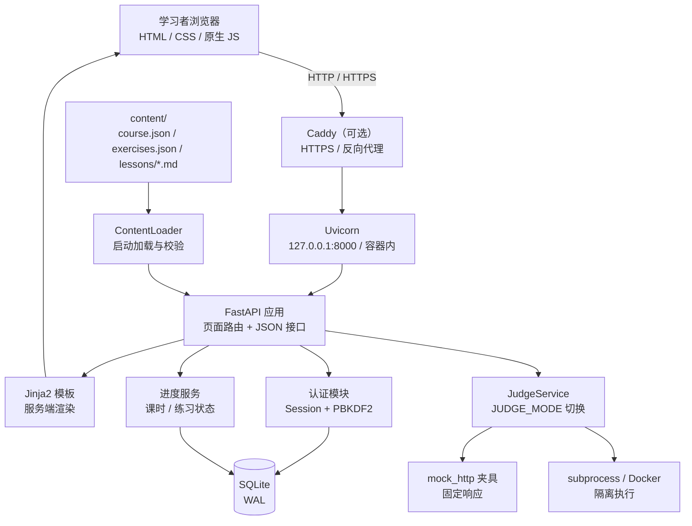

**文字版说明**：浏览器通过 HTTP 或 HTTPS 访问；线上由 Caddy 终止 TLS 并反向代理到 Uvicorn。FastAPI 负责页面渲染和 JSON 接口；认证与进度数据写入 SQLite；课程内容在启动时由 ContentLoader 从 `content/` 加载；站内编程题交给 JudgeService，按 `JUDGE_MODE` 选择 subprocess 或 Docker 执行；HTTP 类站内题由 `mock_http` 夹具提供固定响应；本地作业不进入判题服务。

### 1.3 分层说明

| 层次 | 组成 | 职责 |
|-|-|-|
| 表现层 | Jinja2 模板、HTML、CSS、原生 JS | 页面渲染、练习提交、判题结果展示、本地作业卡片、步骤动画控制 |
| 应用层 | FastAPI 路由、认证模块、进度服务 | 登录态校验、页面路由、练习提交、本地作业完成、进度计算 |
| 内容层 | ContentLoader、Markdown、JSON | 启动时加载课程结构、课时正文、练习配置并校验 |
| 判题层 | JudgeService、mock_http、subprocess / Docker | 执行站内编程题、限制超时、比对输出；本地作业不执行 |
| 安全层 | CSRF、限流、安全响应头、HTTPS 配置 | 保护登录、注册、提交与完成接口 |
| 数据层 | SQLite、SQLAlchemy | 用户、课时进度、练习进度持久化；WAL 模式 |
| 运行层 | Uvicorn、`run.py`、`start.bat`；线上 Docker + Caddy | 建库、初始化演示账号、启动服务、TLS 与反向代理 |

### 1.4 关键流程

#### 1.4.1 页面请求流程

1. 浏览器请求 `/roadmap` 或 `/lessons/{lesson_id}`；
2. FastAPI 校验 Session；
3. 从 ContentLoader 读取课程结构；
4. 从 SQLite 查询当前用户的学习进度；
5. Jinja2 渲染完整 HTML 返回浏览器。

#### 1.4.2 编程题提交流程

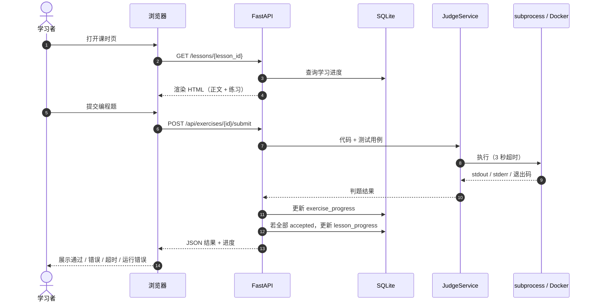

HTTP 类站内题（如 e17）：JudgeService 在判题环境内启动 `mock_http` 夹具，学员代码请求 `127.0.0.1` 的固定响应接口，不访问外网。线上 `JUDGE_MODE=docker` 时容器使用 `--network none`，mock 服务与学员代码在同一容器内。

#### 1.4.3 登录与会话流程

1. 浏览器 GET `/login`，服务端生成 CSRF Token 并写入 Session；
2. 用户提交 `POST /login`，先校验 CSRF Token；
3. 按「IP + 用户名」限流，15 分钟内最多 5 次尝试；
4. 服务端校验用户名与 PBKDF2 密码哈希；
5. 校验通过后清空旧 Session，写入 `user_id`；
6. SessionMiddleware 使用签名 Cookie（HttpOnly、SameSite=Lax、有效期 7 天；线上 `Secure`）；
7. 受保护页面通过 `require_user` 检查登录态，未登录统一 303 跳转 `/login`；
8. `POST /logout` 校验 CSRF 后清空 Session 并回到登录页。

#### 1.4.4 课程内容加载流程

1. 启动时读取 `content/course.json` 与 `content/exercises.json`；
2. 校验阶段、课时、练习 ID 唯一，阶段与课时引用一致；
3. 校验课时文件存在、位于 `content/` 内，练习归属正确；
4. 读取课时 Markdown，预渲染为 HTML；
5. 课程对象驻留内存，运行期只读；
6. 任一步失败都输出文件路径并阻止应用启动。

#### 1.4.5 练习提交流程

1. 前端 `fetch` 提交 `POST /api/exercises/{exercise_id}/submit`，请求头带 `X-CSRF-Token`；
2. 后端校验登录态、CSRF、练习是否存在、提交字段是否合法；
3. 按用户限流，每分钟最多 30 次提交；
4. 单选与填空直接判定；编程题进入 JudgeService；`local_task` 不走该接口，见 1.4.7；
5. JudgeService 在临时目录写入 `main.py`，使用 `python -I -X utf8` 执行；
6. 逐用例比较标准输出，单用例超时 3 秒；整体状态优先级为 `timeout > runtime_error > wrong_answer > accepted`；
7. 每次提交更新 `exercise_progress.status`、`attempts` 与 `last_answer`；`attempts` 仅内部统计；
8. 通过后锁定作答并显示「重做」；错误、超时、运行错误保持可编辑；
9. 课时页重新加载时从 `last_answer` 回填选项、填空或代码；
10. 本课全部练习（含本地作业）当前状态为 `accepted` 时写入 `lesson_progress`；
11. `internal_error` 只返回 HTTP 500，不写入练习进度。

#### 1.4.6 无练习课时标记完成

1. L11 项目任务没有自动判题练习，课时页显示「标记完成」按钮；
2. 前端调用 `POST /api/lessons/{lesson_id}/complete`；
3. 后端只允许 `exercise_ids` 为空的课时手动完成；
4. 有练习的课时返回 400，未知课时返回 404，未登录返回 401；
5. 已完成课时重复调用返回 200，保持幂等；
6. 写入 `lesson_progress` 后，路线完成度与「继续学习」自动更新。

#### 1.4.7 本地作业完成流程（M8 已实现）

1. 课时页渲染 `local_task` 卡片：任务说明、起步代码、分步指引、常见报错、折叠答案；
2. 学员在本机完成后点击「标记完成」；
3. 前端调用 `POST /api/exercises/{exercise_id}/complete`；
4. 后端校验练习存在且 `type=local_task`；非本地作业返回 400；
5. 写入 `exercise_progress.status=accepted`、`attempts+1`，`last_answer` 置空；
6. 若本课全部练习均为 `accepted`，写入或更新 `lesson_progress`；
7. 已完成重复调用返回 200，保持幂等；
8. 学员可「重新练习」，前端临时解锁按钮，不改变已完成的课时状态。

#### 1.4.8 线上请求流程（v2 规划）

1. 浏览器通过 HTTPS 请求 Caddy；
2. Caddy 终止 TLS，反向代理到 Uvicorn；
3. FastAPI 校验 Secure Session Cookie 与 CSRF Token；
4. 页面与接口按本地流程处理；
5. 判题按 `JUDGE_MODE=docker` 启动隔离容器，限制网络、内存、CPU 与 PID；
6. 数据写入挂载持久卷中的 SQLite。

#### 1.4.9 安全校验流程（M9）

1. 所有 HTML 页面通过 `base.html` 输出 `csrf-token` meta，表单带隐藏字段；
2. 所有 JSON POST 通过 `X-CSRF-Token` 请求头校验；
3. CSRF 失败返回 403，提示刷新页面；
4. 登录按「IP + 用户名」限流，注册按 IP 限流，提交与完成按用户限流；
5. 超限返回 429，登录页就地显示「尝试次数过多」；
6. 所有响应加 `X-Content-Type-Options`、`X-Frame-Options`、`Referrer-Policy`、`Permissions-Policy` 与 CSP；
7. `HTTPS_ONLY=true` 时 Cookie 加 `Secure`，并输出 HSTS；
8. `JUDGE_MODE=disabled` 时编程题只读展示，提交接口返回 403。

### 1.5 运行与部署拓扑

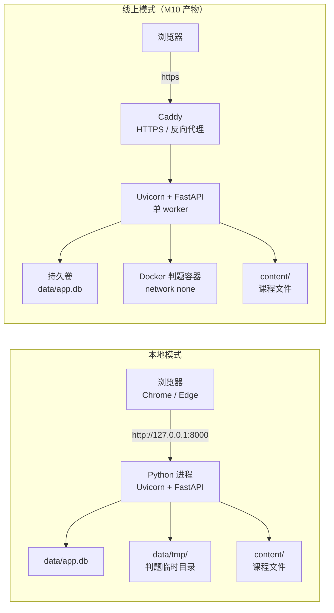

**部署说明**：

- 本地模式不需要 Nginx、域名、HTTPS 证书与 Docker；
- 本地启动命令为 `python run.py`，首次启动自动建库并写入演示账号；
- 数据与课程文件都在项目目录内，整个文件夹可直接拷贝；
- 本地访问地址：`http://127.0.0.1:8000`，健康检查：`/health`；
- 线上模式使用 Docker Compose 启动 app 与 Caddy，Caddy 自动申请 HTTPS 证书；
- 线上 `data/` 挂载持久卷，SQLite 开启 WAL，单 worker；
- 线上判题使用 `JUDGE_MODE=docker`，容器 `--network none`、限制内存/CPU/PID、只读根目录、非 root；无法隔离时设 `JUDGE_MODE=disabled`；
- 生产环境 `APP_SECRET_KEY` 必须固定注入，不使用 `data/secret_key` 自动生成。

**v1.0 已验证记录**：

- M1：Windows + Python 3.13.12 环境下，`GET /` 与 `GET /health` 均返回 200；
- M2：注册、登录、退出、未登录跳转、重复用户名与短密码校验全部通过；
- M3：5 章 8 课、11 道练习、路线页、课时页、Markdown、卡片与步骤动画均正常；
- M4：单选、填空、编程题判题，四态结果、练习进度、课时自动完成与浏览器提交均通过；
- M5：L08 标记完成、重复标记幂等、有练习课时拦截、100% 路线与浏览器跳转均通过；
- M6：8 课视觉组件、5 个新增 SVG、L04–L08 正文与项目任务面板均正常；
- M7：`start.bat`、重启持久化、Edge/Chrome、100% 路线与验收截图均通过。

> 实际启动记录：`docs/screenshots/10-startup.txt`；`start.bat` 与 `/health` 已验证。v3.0 的 11 课、本地作业与线上部署尚未实施，验收记录待补充。

### 1.6 架构取舍

| 取舍 | 选择 | 原因 |
|-|-|-|
| 内容管理 | 文件维护，不做后台 | 内容维护者是开发者本人，省掉一整套 CRUD 界面 |
| 判题执行 | 本地 subprocess / 线上 Docker，配置切换 | 本地零依赖；线上必须隔离，避免公网任意代码执行 |
| 本地作业 | 自报完成，不检查 | 复杂案例需要真实 API 与本机环境；平台只做引导与进度记录 |
| 页面渲染 | 服务端渲染 | 不引入前端框架和构建链，教师更容易运行 |
| 数据库 | SQLite 单文件 | 30 人以内零配置足够；删文件即可重置 |
| 部署 | 本地单进程 / 线上单 worker + Caddy | 不需要水平扩展；SQLite 写入不适宜多 worker |

### 1.7 运行配置（M9）

| 变量 | 默认 | 说明 |
|-|-|-|
| `APP_ENV` | `local` | `production` 时强制要求 `APP_SECRET_KEY` |
| `APP_SECRET_KEY` | 自动生成 | 线上必须固定注入，避免重建后登录态失效 |
| `DATABASE_URL` | `sqlite:///data/app.db` | 可用环境变量覆盖 |
| `HTTPS_ONLY` | `production` 为 `true` | 启用 Secure Cookie 与 HSTS |
| `TRUST_PROXY` | `false` | 在 Caddy/Nginx 后设为 `true`，按 `X-Forwarded-For` 取 IP |
| `JUDGE_MODE` | `subprocess` | `subprocess` / `docker` / `disabled` |
| `JUDGE_DOCKER_IMAGE` | `plg-judge:latest` | 判题容器镜像，含 Python 与 requests |
| `JUDGE_CONCURRENCY` | `2` | 同时运行的判题容器上限，范围 1~4 |
| `DOCKER_BIN` | `docker` | Docker CLI 路径 |
| `PORT` | `8000` | 本地端口 |
| `HOST` | `127.0.0.1` | 本地默认只监听本机 |

---

## 2. 技术选型说明

### 2.1 选型总表

| 层次 | 选型 | 版本 | 职责 | 选择理由 |
|-|-|-|-|-|
| 开发语言 | Python | 3.10+ | 后端、判题、课程示例 | 与教学内容一致，环境统一 |
| Web 框架 | FastAPI | 锁定 `requirements.txt` | 页面路由、JSON 接口 | 轻量、类型友好、AI 生成代码稳定 |
| ASGI 服务器 | Uvicorn | 锁定 `requirements.txt` | 本地启动服务 | 单进程启动简单 |
| 模板引擎 | Jinja2 | 锁定 `requirements.txt` | 服务端渲染 HTML | 不引入 Node 和构建步骤 |
| 前端 | HTML / CSS / 原生 JS | 浏览器原生 | 页面、交互、动画 | 三大件足够，离线可用 |
| 数据库 | SQLite | Python 标准库自带 | 用户与进度持久化 | 零配置、单文件、易重置 |
| ORM | SQLAlchemy | 2.x | 表映射与查询 | 减少手写 SQL，便于维护 |
| Markdown | Python-Markdown | 锁定 `requirements.txt` | 课时正文渲染 | 纯 Python，离线安装 |
| 会话 | Starlette SessionMiddleware + itsdangerous | 锁定 `requirements.txt` | 登录态 | 签名 Cookie，无需额外服务 |
| 密码哈希 | hashlib.pbkdf2_hmac | 标准库 | 密码存储 | 不引入 passlib，减少依赖 |
| HTTP 客户端 | requests | 锁定 `requirements.txt` | 站内 HTTP 题判题、课程示例 | 与教学内容一致，e17 在判题环境内运行 |
| 判题 | subprocess + tempfile；线上 Docker | 标准库 / 容器 | 执行站内编程题 | 本地零依赖；线上隔离 |
| 判题镜像 | `plg-judge:latest` | Python 3.12 + requests | 判题容器运行时 | 与课程 HTTP 题依赖一致 |
| 在线部署 | Docker Compose + Caddy | 可选 | HTTPS、反向代理、持久卷 | 单机小班足够，不引入 K8s |
| 启动 | `run.py` / `start.bat`；线上 compose | 项目自带 | 建库、初始化、启动 | 本地一条命令；线上一条 compose |

### 2.2 关键决策说明

**为什么选 FastAPI，不选 Django**

本项目不需要 Django Admin，因为课程内容用 Markdown/JSON 文件维护；也不需要 Django 的全套 ORM 与中间件。FastAPI 路由更轻，页面与 JSON 接口可以放在同一应用里，开发量更小。

**为什么前端用三大件，不上 React/Vue**

页面以内容阅读和表单提交为主，交互集中在判题提交、步骤动画和进度更新。服务端渲染 + 原生 JS 足够，且不需要 Node、npm 和构建步骤，教师运行成本最低。

**为什么用 SQLite，不用 PostgreSQL**

单机演示、数据量小、并发低。SQLite 不需要安装数据库服务，整个项目拷贝即可运行，删除 `data/app.db` 就能重置数据。

**为什么判题用 subprocess / Docker 双模式**

教师电脑不一定安装 Docker，本地默认用 subprocess，配合 3 秒超时、临时目录和输出截断，足以支撑课堂演示。公网部署不能执行未隔离的任意代码，因此线上默认 `JUDGE_MODE=docker`：容器 `--network none`、限制内存/CPU/PID、只读根目录、非 root。若部署环境不支持容器，则 `JUDGE_MODE=disabled`，只保留选择/填空，或外接独立判题服务。

**为什么课程内容用文件，不做管理后台**

内容维护者是开发者本人，直接编辑 Markdown 和 JSON 比开发一套后台更快，也方便版本管理。代价是修改内容后需要重启服务。

### 2.3 依赖清单

```text
fastapi
uvicorn
jinja2
sqlalchemy
python-multipart
itsdangerous
markdown
requests
```

前端不引入任何 npm 依赖；图片使用本地 SVG；动画使用 CSS 与原生 JS。

平台判题环境需要 `requests`（用于 e17 的 mock HTTP 题）；课程示例额外要求学员安装 `python-dotenv`。线上部署额外使用 Docker 与 Caddy 镜像，不进入 `requirements.txt`。

### 2.4 技术边界与风险

| 风险 | 边界与应对 |
|-|-|
| 本地判题无真实沙箱 | 本地用 subprocess 并明确声明；线上必须 `JUDGE_MODE=docker` 或 `disabled` |
| 公网判题被滥用 | Docker 限制网络/内存/CPU/PID、只读根目录、非 root；判题并发限 2 |
| API Key 泄露 | 加密存储、日志脱敏、界面隐藏；课程中只出现占位 Key |
| 网络与 API 成本 | 练习用 mock/录制回放；真实 API 设超时、重试上限与每日配额 |
| 本地作业自报 | 完成度只作学习参考；30 人以内抽查；后续用轨迹 JSON 规则检查 |
| CSRF/限流缺失 | 登录、提交被脚本刷 | M9 已加 CSRF 与限流；线上继续按 IP/用户限流 |
| Docker socket 暴露 | app 容器可通过 socket 控制宿主机 Docker | 只在可信服务器使用；无法接受时 `JUDGE_MODE=disabled` |
| 判题镜像缺失 | `--pull=never` 直接返回运行错误 | 部署时先构建 `plg-judge:latest` |
| 死循环代码 | 单用例 3 秒超时并终止子进程 |
| SQLite 并发写入 | 30 人以内；单 worker、WAL、每次请求独立 Session、短事务 |
| Windows 中文乱码 | 全项目 UTF-8；子进程使用 `-X utf8` 并以 UTF-8 解码 |
| 外链资源失效 | 图片、CSS、JS 全部本地化，断网可用 |
| 端口冲突 | 支持 `PORT` 环境变量覆盖 |

> 已有实测：首页本地响应正常；判题单用例约 20–60ms（含进程启动）；超时上限 3 秒。未做 30 人并发压力测试。

---

## 3. 数据库设计

### 3.1 设计原则

- 数据库只保存**用户产生的状态**：账号、课时进度、练习进度；
- 课程正文、练习题目、测试用例全部放在 `content/` 文件中，不进入数据库；
- 不保存提交历史，只保留每道练习的最新状态和提交次数；
- 本地作业只保存完成状态，不保存代码、文件或截图；
- 所有表使用整数主键，时间统一存 ISO 字符串；
- 用户删除时，其进度数据级联删除。

### 3.2 ER 图

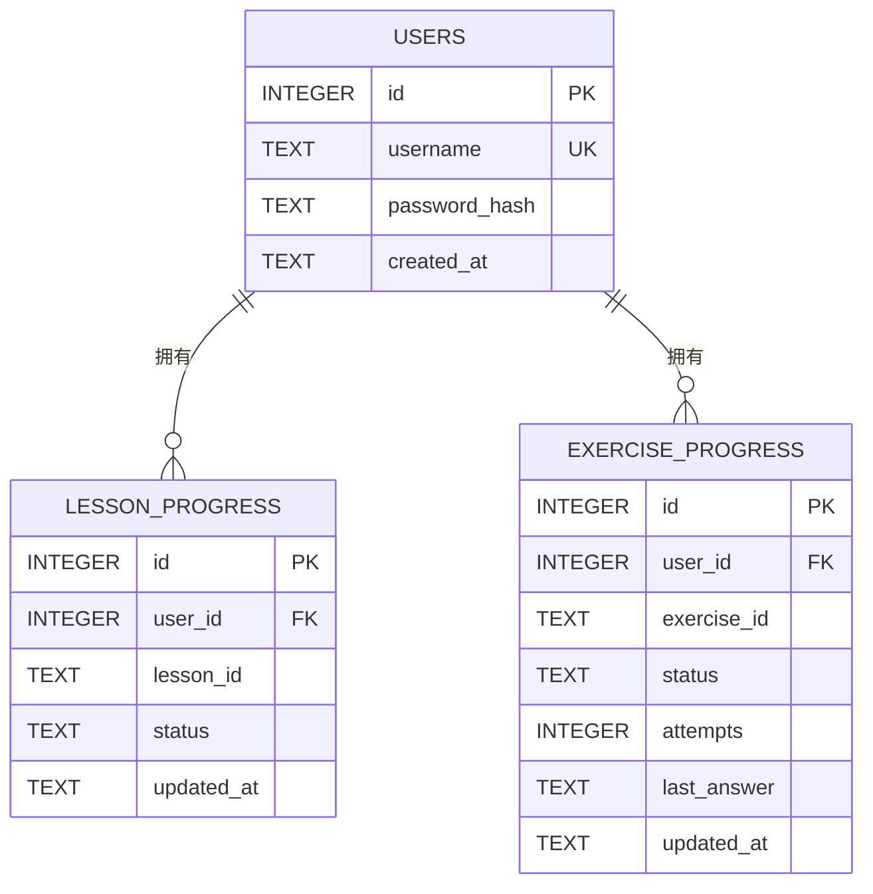

### 3.3 表结构

#### 3.3.1 users

| 字段 | 类型 | 约束 | 说明 |
|-|-|-|-|
| id | INTEGER | 主键，自增 | 用户 ID |
| username | TEXT | 唯一，非空 | 登录名，3~20 字符 |
| password_hash | TEXT | 非空 | 格式 `pbkdf2_sha256$迭代次数$盐$哈希` |
| created_at | TEXT | 非空 | 注册时间，ISO 8601 |

索引：`username` 唯一索引。

#### 3.3.2 lesson_progress

| 字段 | 类型 | 约束 | 说明 |
|-|-|-|-|
| id | INTEGER | 主键，自增 | 记录 ID |
| user_id | INTEGER | 外键 users.id，非空，级联删除 | 用户 ID |
| lesson_id | TEXT | 非空 | 课程文件中的课时 ID，如 `l03` |
| status | TEXT | 非空，默认 `completed` | 课时状态 |
| updated_at | TEXT | 非空 | 最后更新时间 |

约束：`UNIQUE(user_id, lesson_id)`。  
索引：`user_id`。

**状态取值**：只有 `completed`。没有记录视为「未开始」。

#### 3.3.3 exercise_progress

| 字段 | 类型 | 约束 | 说明 |
|-|-|-|-|
| id | INTEGER | 主键，自增 | 记录 ID |
| user_id | INTEGER | 外键 users.id，非空，级联删除 | 用户 ID |
| exercise_id | TEXT | 非空 | 练习 ID，如 `e03` |
| status | TEXT | 非空 | 最近一次判题状态；本地作业为完成状态 |
| attempts | INTEGER | 非空，默认 0 | 累计提交/完成次数，仅内部统计 |
| last_answer | TEXT | 可空 | 最新一次作答内容：选项索引、填空答案或代码；本地作业为空 |
| updated_at | TEXT | 非空 | 最后更新时间 |

约束：`UNIQUE(user_id, exercise_id)`。  
索引：`user_id`。

**状态取值**：

| 值 | 含义 |
|-|-|
| `accepted` | 站内题通过；本地作业已完成 |
| `wrong_answer` | 答案错误 |
| `timeout` | 超时 |
| `runtime_error` | 运行错误 |

`local_task` 只使用 `accepted`，不产生 `wrong_answer` / `timeout` / `runtime_error`。

#### 3.3.4 实际建表语句（M1 已实现）

以下 DDL 由 SQLAlchemy `Base.metadata.create_all` 生成，来自实际 SQLite 数据库：

```sql
CREATE TABLE users (
    id INTEGER NOT NULL,
    username VARCHAR(32) NOT NULL,
    password_hash VARCHAR(255) NOT NULL,
    created_at VARCHAR(32) NOT NULL,
    PRIMARY KEY (id)
);
CREATE UNIQUE INDEX ix_users_username ON users (username);

CREATE TABLE lesson_progress (
    id INTEGER NOT NULL,
    user_id INTEGER NOT NULL,
    lesson_id VARCHAR(16) NOT NULL,
    status VARCHAR(16) NOT NULL,
    updated_at VARCHAR(32) NOT NULL,
    PRIMARY KEY (id),
    CONSTRAINT uq_lesson_progress_user_lesson UNIQUE (user_id, lesson_id),
    FOREIGN KEY(user_id) REFERENCES users (id) ON DELETE CASCADE
);
CREATE INDEX ix_lesson_progress_user_id ON lesson_progress (user_id);

CREATE TABLE exercise_progress (
    id INTEGER NOT NULL,
    user_id INTEGER NOT NULL,
    exercise_id VARCHAR(16) NOT NULL,
    status VARCHAR(16) NOT NULL,
    attempts INTEGER NOT NULL,
    last_answer TEXT,
    updated_at VARCHAR(32) NOT NULL,
    PRIMARY KEY (id),
    CONSTRAINT uq_exercise_progress_user_exercise UNIQUE (user_id, exercise_id),
    FOREIGN KEY(user_id) REFERENCES users (id) ON DELETE CASCADE
);
CREATE INDEX ix_exercise_progress_user_id ON exercise_progress (user_id);
```

> 已有数据库启动时，若 `exercise_progress` 缺少 `last_answer`，`init_db` 会自动执行 `ALTER TABLE ... ADD COLUMN`，不需要清空数据。

### 3.4 关键数据流

**注册**

1. 校验用户名长度与重复；
2. 生成随机盐，使用 PBKDF2-SHA256 计算密码哈希；
3. 写入 `users`。

**登录**

1. 按用户名查询 `users`；
2. 用相同盐与迭代次数验证密码；
3. 验证通过后写入签名 Session Cookie。

**提交练习**

1. 校验登录态、练习 ID 与题型；
2. 概念题直接比对答案；编程题调用 JudgeService；
3. 更新 `exercise_progress` 的 `status`、`attempts`、`last_answer`、`updated_at`；
4. 查询该课时全部练习，若均为 `accepted`，写入或更新 `lesson_progress`；
5. 返回判题结果与最新完成度。

**完成本地作业（v2 规划）**

1. 校验登录态、练习存在且 `type=local_task`；
2. 写入 `exercise_progress.status=accepted`、`attempts+1`、`last_answer=NULL`；
3. 查询该课时全部练习，若均为 `accepted`，写入或更新 `lesson_progress`；
4. 返回完成状态与最新完成度；
5. 重复调用幂等，不新增记录。

**进度计算**

1. 读取 ContentLoader 中的总课时数；
2. 查询当前用户 `lesson_progress` 中 `completed` 的记录数；
3. 完成度 = 已完成课时数 ÷ 总课时数 × 100%，四舍五入取整。

### 3.5 初始化与重置

- 数据库文件：`data/app.db`；
- 首次启动执行建表；
- 若演示账号不存在，写入 `demo / demo123`；
- 删除 `data/app.db` 后重启，即恢复初始状态；
- 外键约束开启：`PRAGMA foreign_keys = ON`；
- v2 线上启用 WAL：`PRAGMA journal_mode = WAL`，并设置 `busy_timeout = 5000`；
- 线上单 worker，避免多进程写 SQLite。

> 实际建表语句已补充至 3.3.4，并由 SQLite 实际 schema 校验。

### 3.6 课时 ID 迁移（v2）

新增 L07–L09 后，原 `l07`（SQLite）与 `l08`（FastAPI）顺延为 `l10`、`l11`。已有数据库需要迁移：

```sql
UPDATE lesson_progress SET lesson_id = 'l10' WHERE lesson_id = 'l07';
UPDATE lesson_progress SET lesson_id = 'l11' WHERE lesson_id = 'l08';
```

- `exercise_progress` 以 `exercise_id` 为主，不需要迁移；
- e11 的 `lesson_id` 在 `content/exercises.json` 中改为 `l10`；
- 若没有需要保留的学习进度，直接删除 `data/app.db` 重新初始化即可。

---

## 4. 界面设计

### 4.1 设计原则

- **路径优先**：用户进入首页后，第一眼看到「当前该学哪一课」；
- **低认知负担**：一屏只突出一个主任务，减少装饰性元素；
- **卡片化**：抽象概念用图文卡片承载，避免大段纯文字；
- **即时反馈**：练习提交后立即显示结果，不跳页；
- **纸上课堂**：暖纸色背景、墨色正文、朱红与橄榄绿点缀；路线像书的目录，卡片像便签，避免通用蓝紫渐变；
- **桌面优先**：以 1280px 及以上宽度设计，移动端不作为验收重点；
- **离线可用**：不引用在线字体、图标、图片。

### 4.2 页面清单

| 页面 | 路由 | 主要内容 | 状态 |
|-|-|-|-|
| 登录页 | `/login` | 用户名、密码、登录按钮、注册入口 | 已实现（M2） |
| 注册页 | `/register` | 用户名、密码、确认密码、注册按钮 | 已实现（M2） |
| 学习路线页 | `/roadmap` | 章节、课时、完成状态、完成度、继续学习 | 已实现（M3） |
| 课时页 | `/lessons/{lesson_id}` | 正文、视觉卡片、步骤动画、练习（查看用例、恢复作答、通过锁定、重做）、卡片点击放大、上下课导航 | 已实现（M3/M4；放大为 M10 后增强） |
| 判题结果 | 课时页内联 | 通过、答案错误、超时、运行错误 | 已实现（M4） |
| 项目任务 | L11 课时页内联 | 任务清单、标记完成 | 已实现（M5；v2 顺延为 L11） |
| 本地作业 | 课时页内联 | 任务说明、起步代码、步骤、折叠答案、标记完成 | 已实现（M8） |

### 4.3 低保真原型

以下原型为开发前的线框图，用于确认信息层级与交互位置；实际截图在开发完成后补充。

#### 4.3.1 登录页

```text
┌──────────────────────────────────────────────────────────────┐
│ 从零开始Agent学习                                             │
├──────────────────────────────────────────────────────────────┤
│                                                              │
│                 ┌────────────────────────────┐               │
│                 │  欢迎回来                  │               │
│                 │                            │               │
│                 │  用户名                    │               │
│                 │  [______________________]  │               │
│                 │                            │               │
│                 │  密码                      │               │
│                 │  [______________________]  │               │
│                 │                            │               │
│                 │  [        登  录        ]  │               │
│                 │                            │               │
│                 │  还没有账号？去注册 →      │               │
│                 └────────────────────────────┘               │
│                                                              │
└──────────────────────────────────────────────────────────────┘
```

#### 4.3.2 学习路线页

```text
┌──────────────────────────────────────────────────────────────┐
│ 从零开始Agent学习                          demo   [ 退出 ]   │
├──────────────────────────────────────────────────────────────┤
│ Python 从零到 Web 应用 · Agent 先修        完成度 27%         │
│ [████████░░░░░░░░░░░░░░░░░░░░░░░░░░░░░░░]                   │
│ [ 继续学习：L04 函数 ]                                       │
├──────────────────────────────────────────────────────────────┤
│ 第一章 环境配置                                              │
│  [x] L01 安装 Python 并运行第一个程序          已完成        │
│                                                              │
│ 第二章 基础语法                                              │
│  [x] L02 变量与数据类型                        已完成        │
│  [x] L03 条件与循环                            已完成        │
│                                                              │
│ 第三章 核心语法                                              │
│  [>] L04 函数                                  进行中        │
│  [ ] L05 列表与字典                            未开始        │
│  [ ] L06 类与对象                              未开始        │
│                                                              │
│ 第四章 连接外部世界                                          │
│  [ ] L07 JSON 与文件读写                       未开始        │
│  [ ] L08 HTTP 与真实 API                       未开始        │
│  [ ] L09 异常、环境变量与密钥                  未开始        │
│                                                              │
│ 第五章 数据库                                                │
│  [ ] L10 SQLite 与 CRUD                        未开始        │
│                                                              │
│ 第六章 Web 实战                                              │
│  [ ] L11 用 FastAPI 做留言板                   未开始        │
└──────────────────────────────────────────────────────────────┘
```

#### 4.3.3 课时页

```text
┌──────────────────────────────────────────────────────────────┐
│ 从零开始Agent学习                          demo   [ 退出 ]   │
├──────────────────────────────────────────────────────────────┤
│ 第二章 > L03 条件与循环                                      │
│                                                              │
│ 学习目标                                                     │
│  · 能用 if / elif / else 做条件判断                          │
│  · 能用 for / while 重复执行                                 │
│                                                              │
│ ┌────────────────────────────┐ ┌───────────────────────────┐ │
│ │ 概念卡：条件判断像岔路口   │ │ 图示：if / else 分支      │ │
│ │ 满足条件走一条路，否则走   │ │                           │ │
│ │ 另一条路。                 │ │                           │ │
│ └────────────────────────────┘ └───────────────────────────┘ │
│                                                              │
│ 3.2 if / elif / else                                         │
│ 正文内容……                                                   │
│ ┌──────────────────────────────────────────────────────────┐ │
│ │ score = 75                                               │ │
│ │ if score >= 60:                                          │ │
│ │     print("及格")                                        │ │
│ └──────────────────────────────────────────────────────────┘ │
│                                                              │
│ ┌──────────────────────────────────────────────────────────┐ │
│ │ 步骤动画  第 1 / 3 步                                    │ │
│ │ 图示区域                                                 │ │
│ │ [上一步]  [下一步]  [重播]                               │ │
│ └──────────────────────────────────────────────────────────┘ │
│                                                              │
│ 练习 1：判断循环输出结果                                     │
│ ( ) A. 1 2 3                                                 │
│ ( ) B. 0 1 2                                                 │
│ [ 提交答案 ]                                                 │
├──────────────────────────────────────────────────────────────┤
│ [ ← 上一课 ]                                  [ 下一课 → ]   │
└──────────────────────────────────────────────────────────────┘
```

#### 4.3.4 编程练习与判题结果

```text
┌──────────────────────────────────────────────────────────────┐
│ 练习 2：判断奇偶                                             │
│ ┌──────────────────────────────────────────────────────────┐ │
│ │ 1  n = int(input())                                      │ │
│ │ 2  if n % 2 == 0:                                        │ │
│ │ 3      print("偶数")                                     │ │
│ │ 4  else:                                                 │ │
│ │ 5      print("奇数")                                     │ │
│ └──────────────────────────────────────────────────────────┘ │
│ [ 提交判题 ]                                                 │
│                                                              │
│ ┌── 判题结果 ──────────────────────────────────────────────┐ │
│ │ [通过]  用时 120ms                                       │ │
│ │ 全部 3 个测试用例通过                                    │ │
│ └──────────────────────────────────────────────────────────┘ │
└──────────────────────────────────────────────────────────────┘
```

**判题结果状态**：

| 状态 | 展示文案 | 颜色 | 附加信息 |
|-|-|-|-|
| `accepted` | 通过 | 绿色 | 耗时、测试用例数 |
| `wrong_answer` | 答案错误 | 红色 | 失败用例的期望输出与实际输出 |
| `timeout` | 超时 | 橙色 | 提示「运行超过 3 秒」 |
| `runtime_error` | 运行错误 | 红色 | 截断后的错误信息 |

#### 4.3.5 项目任务（L11）

```text
┌──────────────────────────────────────────────────────────────┐
│ 项目任务：完成留言板                                         │
│                                                              │
│ 请完成以下检查项：                                           │
│  [ ] 页面能显示留言列表                                      │
│  [ ] 表单能提交新留言                                        │
│  [ ] 提交后页面自动刷新                                      │
│  [ ] 重启服务后留言仍然存在                                  │
│                                                              │
│ [ 标记完成 ]                                                 │
└──────────────────────────────────────────────────────────────┘
```

#### 4.3.6 本地作业卡片（M8 已实现）

```text
┌──────────────────────────────────────────────────────────────┐
│ 本地作业：搭好 Python 工作台                                 │
│ 在本机创建虚拟环境、安装 requests，并运行脚本。              │
│                                                              │
│ 步骤                                                         │
│  1. python -m venv .venv                                     │
│  2. .venv\Scripts\activate                                   │
│  3. pip install requests                                     │
│  4. python check.py                                          │
│                                                              │
│ 起步代码                                          [复制]     │
│ ┌──────────────────────────────────────────────────────────┐ │
│ │ import requests                                          │ │
│ │ print(requests.__version__)                              │ │
│ └──────────────────────────────────────────────────────────┘ │
│                                                              │
│ ▸ 参考答案（先自己跑一遍再看）                               │
│                                                              │
│ [ 标记完成 ]                                                 │
│ 完成后：已完成 · [ 重新练习 ]                                │
└──────────────────────────────────────────────────────────────┘
```

### 4.4 视觉规范

**色彩**

| Token | 值 | 用途 |
|-|-|-|
| `--paper` | `#F4EFE4` | 页面背景 |
| `--paper-deep` | `#ECE4D4` | 分区底色 |
| `--surface` | `#FFFCF5` | 卡片、表单背景 |
| `--ink` | `#1F2933` | 正文 |
| `--ink-soft` | `#4A4A40` | 次级正文 |
| `--muted` | `#6B6B5E` | 辅助说明 |
| `--line` | `#D8CFC0` | 边框、分割线 |
| `--line-strong` | `#B9AD99` | 强调边框 |
| `--accent` | `#B4442A` | 主按钮、链接、进度条 |
| `--accent-deep` | `#8F3420` | 主按钮悬停 |
| `--olive` | `#4D7C0F` | 次强调、完成状态 |
| `--success` | `#3F7D4A` | 判题通过 |
| `--warning` | `#B7791F` | 超时、提醒 |
| `--danger` | `#B42318` | 答案错误、运行错误 |
| `--radius` | `14px` | 卡片圆角 |
| `--shadow` | `0 2px 0 rgba(31,41,51,0.06)` | 卡片纸感阴影 |

**字体**

- 标题：`"Songti SC", "STSong", "SimSun", "Noto Serif SC", Georgia, serif`；
- 正文：`"Microsoft YaHei", "PingFang SC", "Segoe UI", sans-serif`；
- 代码：`"Cascadia Code", Consolas, "Courier New", monospace`；
- 正文 16px / 行高 1.8；首页一级标题 48px，内容页一级标题 28px；二级标题 22px；代码 14px；辅助文字 13px。

**间距与布局**

- 页面最大宽度 1120px，课时正文最大宽度 760px；
- 间距使用 4 / 8 / 16 / 24 / 32 的倍数；
- 卡片内边距 20px，卡片间距 16px；
- 按钮高度 40px，水平内边距 16px；
- 输入框高度 40px，聚焦时显示 2px 朱红描边；
- 页面背景使用 CSS 渐变模拟纸张纹理，不加载背景图片。

**组件规范**

| 组件 | 规范 |
|-|-|
| 主按钮 | 朱红背景、纸白文字、圆角 8px |
| 次按钮 | 纸白底、墨色边框、朱红文字 |
| 概念卡 | 纸白底、1px 边框、圆角 14px、纸感阴影，图片在上、文字在下 |
| 对比卡 | 左右两栏，错误用朱红浅底，正确用橄榄绿浅底 |
| 提示卡 | 浅纸底 + 左侧 4px 橄榄色条 |
| 代码块 | 墨色背景 `#1F2933`、纸白文字、横向滚动 |
| 结果徽章 | 浅色底 + 对应状态色文字 |
| 卡片放大层 | 固定遮罩 + 居中面板；面板最大宽 1100px、高 90vh；卡片图片放大、文字加大；右上角关闭按钮 |
| 进度条 | 高 8px，圆角 999px，朱红填充 |

### 4.5 交互状态

| 场景 | 交互 |
|-|-|
| 登录失败 | 表单下方显示「用户名或密码错误」，不清空用户名 |
| 注册失败 | 就地提示重复用户名或密码长度不足 |
| 判题中 | 提交按钮禁用，文案变为「判题中…」 |
| 判题完成 | 结果卡片就地展开，不刷新页面；路线完成度同步更新 |
| 答案错误 | 展示第一个失败用例的期望输出与实际输出 |
| 超时 | 展示「运行超过 3 秒，请检查是否存在死循环」 |
| 运行错误 | 展示截断后的错误信息，最多 2000 字符 |
| 步骤动画 | 首步禁用「上一步」，末步禁用「下一步」，重播回到第 1 步 |
| 空进度 | 路线页显示「从第一课开始」引导，不显示空白区块 |
| 无练习课时 | 显示「标记完成」按钮 |
| 本地作业完成 | 点击「标记完成」后就地显示「已完成」，按钮变为「重新练习」；不刷新页面 |
| 本地作业答案 | 默认收起，点击展开参考答案；不强制完成前查看 |
| 本地作业重复完成 | 已完成后再次点击返回成功，保持幂等，不新增记录 |
| 卡片放大 | 点击概念卡、对比卡、提示卡打开灯箱；图片与文字放大；支持 Esc、遮罩、关闭按钮 |
| 卡片放大键盘 | 卡片可 Tab 聚焦，Enter / Space 打开；打开后焦点进入关闭按钮，Tab 在放大层内循环 |
| 判题关闭 | `JUDGE_MODE=disabled` 时，编程题显示「线上暂不开放编程判题」，保留选择/填空 |

### 4.6 响应式与兼容性

- 主要适配 1280px、1440px、1920px 桌面宽度；
- 900px 以下卡片改为单列，保证内容可读；
- 移动端不作为验收重点，代码编辑建议在电脑上完成；
- 支持 Chrome / Edge 最近两个大版本；
- 不引用在线字体与图标，断网仍可正常显示。

> 实际兼容性：Edge 1440×1000 全流程截图通过；Chrome 登录与路线 smoke test 通过。

### 4.7 实际验收截图

以下截图由 Edge 浏览器在 1440×1000 视口下生成，文件位于 `docs/screenshots/`，对应 v1.0 的 8 课版本。

> v3.0 的 11 课路线、本地作业卡片与 mock HTTP 判题截图待开发完成后补充。

#### 4.7.1 登录与路线

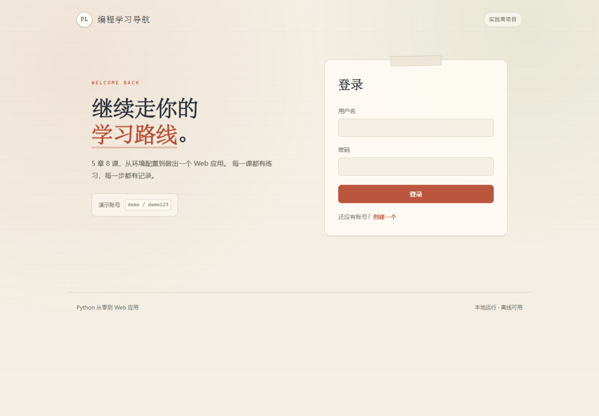

<p align="center">登录页</p>

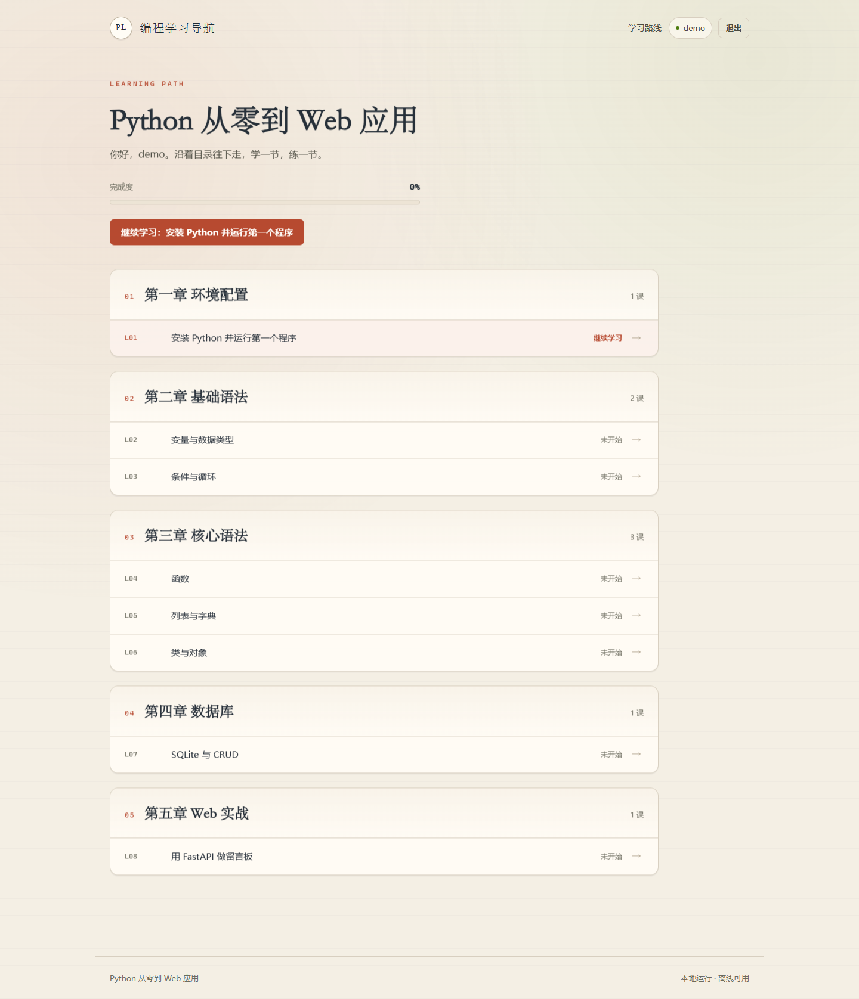

<p align="center">初始学习路线，完成度 0%</p>

#### 4.7.2 课时与测试用例

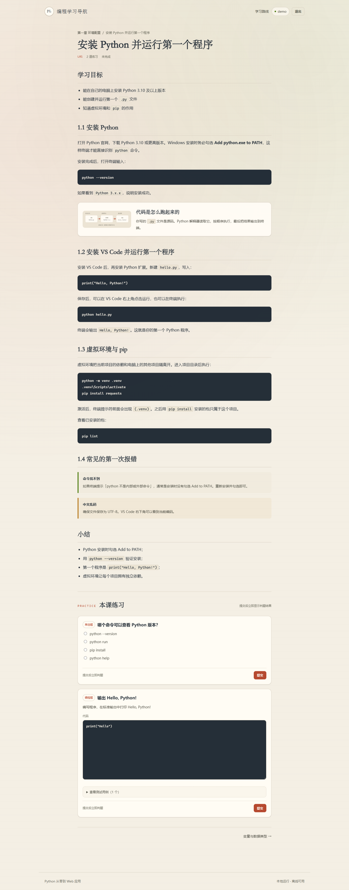

<p align="center">L01 课时正文与概念卡</p>

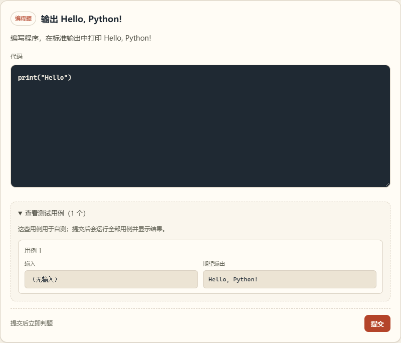

<p align="center">编程题测试用例展开</p>

#### 4.7.3 判题与项目任务

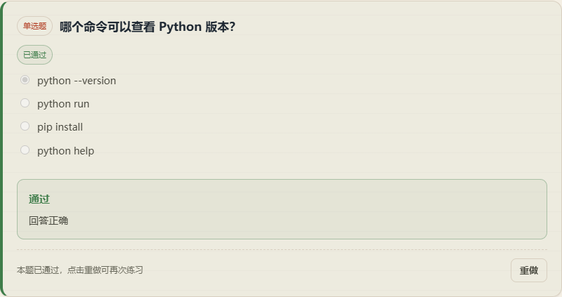

<p align="center">单选题通过、作答锁定与重做按钮</p>

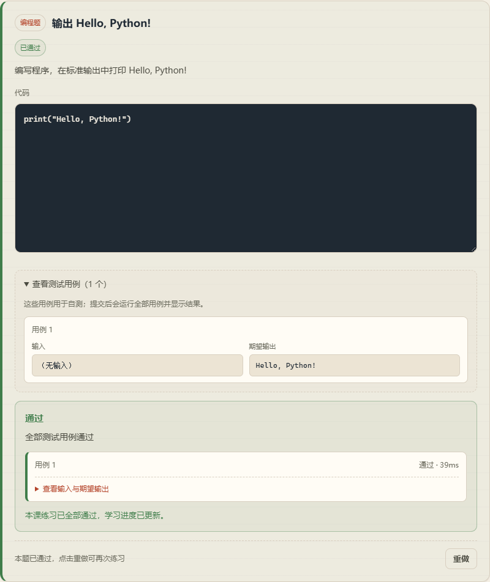

<p align="center">编程题通过、逐用例结果与重做按钮</p>

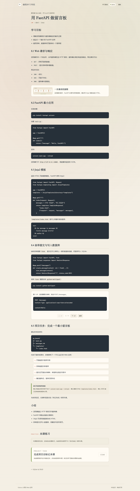

<p align="center">L08 项目任务已完成</p>

#### 4.7.4 进度完成

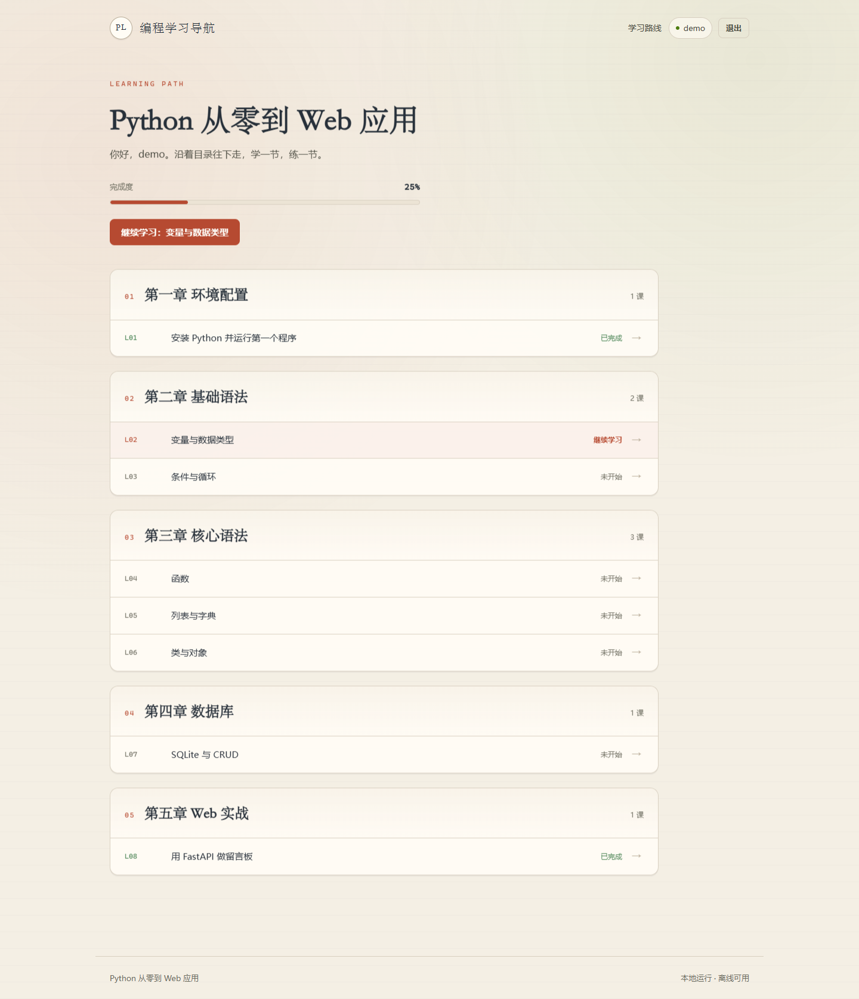

<p align="center">L01 / L08 完成后的 25% 路线</p>

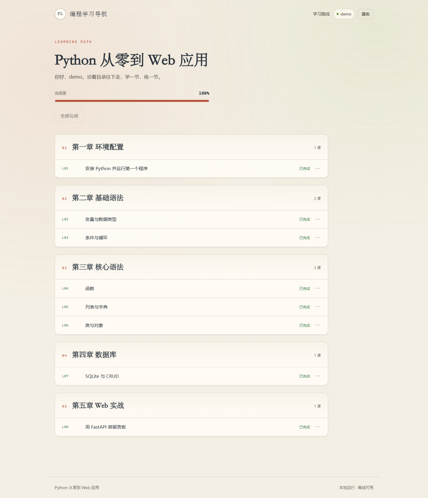

<p align="center">全部完成 100% 与「全部完成」</p>

启动记录：[docs/screenshots/10-startup.txt](docs/screenshots/10-startup.txt)。Chrome 登录与路线 smoke test 通过。

---

## 5. 待开发后补充清单

| 序号 | 待补充内容 | 补充时机 | 放置位置 | 状态 |
|-|-|-|-|-|
| 1 | 登录、路线、课时、判题结果实际截图 | 前端页面完成后 | 4.7 / `docs/screenshots/` | 已完成 |
| 2 | 启动成功与控制台输出截图 | `run.py` 可运行后 | 1.5 | 已完成（`10-startup.txt`） |
| 3 | 实际数据库表结构（`.schema` 或截图） | 数据模型实现后 | 3.3.4 | 已补充 |
| 4 | 接口实测请求与响应示例 | 接口联调完成后 | 1.4 / 附录 | `/health`、登录、注册、退出、路线、课时、练习提交、标记完成均已验证 |
| 5 | 判题四态实测截图 | 判题服务完成后 | 4.3.4 | 四态已实测；通过态截图见 4.7，其余以 API 记录为准 |
| 6 | 首页响应与判题耗时数据 | 性能测试完成后 | 2.4 | 判题耗时已实测，未做压力测试 |
| 7 | Chrome / Edge 兼容性记录 | 验收前 | 4.6 | Edge 截图通过，Chrome smoke test 通过 |
| 8 | 实际运行环境信息（Python 版本、系统版本） | 部署验收时 | 1.5 | 已记录（Python 3.13.12 / Windows） |
| 9 | L07–L09 正文与视觉素材 | v2 开发完成后 | 3.3 / 4.7 | 待开发 |
| 10 | 21 道练习与本地作业卡片截图 | v2 开发完成后 | 3.3.4 / 4.3.6 | 待开发 |
| 11 | mock HTTP 判题实测 | v2 开发完成后 | 1.4.2 / 5.7 | 待开发 |
| 12 | 线上部署实测（HTTPS、CSRF、限流） | v2 上线前 | 1.5 | 待开发 |
| 13 | 课时 ID 迁移验证 | v2 开发完成后 | 3.6 | 待开发 |
| 14 | 30 人并发与判题耗时 | v2 上线前 | 2.4 | 待补充 |

---

## 附录 A：与 PRD 的对应关系

| 本文档章节 | 对应 PRD 内容 |
|-|-|
| 1. 总体架构 | 第 5 章技术架构方案、5.2 架构说明 |
| 2. 技术选型说明 | 5.1 技术栈定稿 |
| 3. 数据库设计 | 5.4 数据模型、3.2 业务规则 |
| 4. 界面设计 | 3.1 功能列表、3.3 课程内容设计、5.5 页面与路由清单 |
| 1.4.7 本地作业 / 1.4.8 线上流程 | 3.2 业务规则、F-15 / F-17 |
| 3.6 课时 ID 迁移 | 3.2 课程顺序 |
| 5. 待补充清单 | 第 8 章验收清单 |

## 附录 B：版本记录

| 版本 | 日期 | 说明 |
|-|-|-|
| v3.2 | 2026-11-03 | M10 部署产物：Dockerfile、judge.Dockerfile、compose、Caddyfile、DEPLOY.md 与 Docker 判题 |
| v3.1 | 2026-11-03 | M9 上线加固：CSRF、限流、HTTPS 配置、安全响应头、WAL 与 `JUDGE_MODE=disabled` |
| v3.0 | 2026-11-03 | Agent 先修扩展：11 课结构、`local_task` 题型、mock HTTP 判题、课时迁移与上线部署规划 |
| v2.0 | 2026-10-29 | M7 交付验收：实际截图、启动记录、兼容性验证与验收清单闭环 |
| v1.9 | 2026-10-29 | 增加通过锁定、错误重做、重做按钮与去除提交次数展示说明 |
| v1.8 | 2026-10-29 | 增加 last_answer 作答恢复字段、课时页回填与轻量迁移说明 |
| v1.7 | 2026-10-29 | 补充 M6 内容深化、8 课视觉组件与新增 SVG |
| v1.6 | 2026-10-29 | 补充 M5 无练习课时标记完成、完成度收尾与验证记录 |
| v1.5 | 2026-10-29 | 增加编程题测试用例展开查看，更新课时页与判题说明 |
| v1.4 | 2026-10-29 | 补充 M4 练习提交、判题服务、四态结果、进度写入与验证记录 |
| v1.3 | 2026-10-28 | 补充 M3 课程加载、路线页、课时页、视觉组件与验证记录 |
| v1.2 | 2026-10-28 | 补充 M2 账号体系、登录会话流程、页面实现状态与验证记录 |
| v1.1 | 2026-10-27 | 补充 M1 实现状态、实际建表语句、纸上课堂视觉规范 |
| v1.0 | 2026-10-26 | 初版：架构、选型、数据库、低保真原型 |

## 附录 C：实现进度

| 模块 | 状态 | 验证记录 |
|-|-|-|
| M1 项目骨架 | 已完成 | `python run.py` 启动成功；`/` 与 `/health` 返回 200；三张表、索引、演示账号与密码哈希校验通过 |
| M2 账号体系 | 已完成 | 注册、登录、退出、未登录跳转、重复用户名与短密码校验均通过；演示账号登录成功 |
| M3 课程链路 | 已完成 | 5 章 8 课、11 道练习、路线页、课时页、Markdown、概念卡与步骤动画均验证通过 |
| M4 练习判题 | 已完成 | 单选/填空/编程判题、四态结果、测试用例展开、作答恢复、通过锁定与重做均验证通过 |
| M5 进度体系 | 已完成 | L08 标记完成、幂等处理、有练习课时拦截、100% 路线与浏览器验证均通过 |
| M6 演示内容 | 已完成 | L04–L08 正文深化、5 个新 SVG、8 课视觉组件与内容校验均通过 |
| M7 交付验收 | 已完成 | `start.bat`、重启持久化、Edge/Chrome 验证、9 张截图、启动记录与验收清单均完成 |
| M8 Agent 先修内容 | 已完成 | 11 课、21 道练习、`local_task` 完成接口、mock HTTP 判题均验证通过 |
| M9 上线加固 | 已完成 | CSRF 拦截 403、6 次失败登录 429、安全响应头、WAL 与 `JUDGE_MODE=disabled` 均验证通过 |
| M10 部署交付 | 产物已完成 | Dockerfile、judge.Dockerfile、compose、Caddyfile、`DEPLOY.md`；容器运行待部署服务器验证 |
